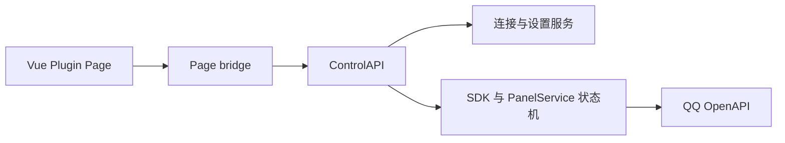

# Vue 控制页面与 SDK 集成

QQ V2 的控制页面是 AstrBot Plugin Page。页面负责展示状态、编辑非敏感草稿和发起经过确认的管理操作；QQ 网络请求、平台生命周期、权限检查和操作恢复由插件后端负责。Vue 页面不能直接导入 Python SDK，也不能从浏览器直接请求 QQ OpenAPI。

## 页面入口

正式入口是 `pages/control/index.html`。用户应从 AstrBot 的插件视图（Plugin Views / Pages）打开它，页面通过 `window.AstrBotPluginView`（兼容 `window.AstrBotPluginPage`）获取宿主提供的 `ready()`、`getContext()`、`onContext()`、`t()`、`apiGet()` 和 `apiPost()` 桥接方法，自动同步宿主的亮暗主题（`data-theme="light|dark"`）与当前语言（`.astrbot-plugin/i18n/<locale>.json`）。

`dash/` 保存 Vue 源码、Vite 配置和单文件构建入口，构建产物直接输出到 `pages/control/index.html`（内联全部 JS 与 CSS，无需外部静态资源请求）。

## 请求链路



ControlAPI 注册在插件命名空间下，当前页面使用这些请求组：

| 用途 | 请求 | 后端职责 |
| --- | --- | --- |
| 初始化 | `bootstrap` | 返回 CSRF、全局开关、实例列表和设置默认值，不返回凭据。 |
| 连接与接入 | `connection`、`connection/save`、`connection/reload` | 读取宿主配置；`connection/save` 保存连接并应用实例运行策略，重载仍单独确认。 |
| 扫码绑定 | `onboarding/start`、`onboarding/status`、`onboarding/cancel`、`onboarding/commit` | 管理短期扫码租约，提交凭据时执行身份和凭据确认。 |
| 本地菜单 | `config`、`commands`、`preview`、`config/mutate` | 读取设置草稿、命令目录和本地预览；`apply` 只改变本地运行设置。 |
| QQ 面板 | `panels/plan`、`panels/enable`、`panels/sync`、`panels/disable`、`panels/status` | 预览范围、确认托管、同步或停止同步指定的远端面板。 |
| 全局开关 | `flags` | 修改 WebUI 和远端面板同步开关。 |
| 保留事件 | `inbox/retained`、`inbox/discard` | 查看元数据并在短期确认窗口内明确丢弃事件。 |
| 消息历史 | `history/status`、`history/query`、`history/message`、`history/policy`、`history/integrity`、`history/checkpoint`、`history/export`、`history/delete`、`history/purge` | 独立历史库的策略、查询和维护；`history/query` 支持全文检索（FTS5，失败则 LIKE 降级）并返回 `search_mode`；补索引进度在 `status.search`。危险操作需确认，且只影响消息历史。 |
| 资料库 | `profile/status`、`profile/policy` | 插件级资料库限制；保存后立即生效，不带 `platform_id`，不写入实例代次。新字节上限低于当前占用时拒绝。 |

每个管理请求都必须由页面桥接对象发送。POST 请求携带 `csrf`；涉及写入的连接和平台请求携带 `platform_id` 与当前 `fingerprint`；菜单草稿和预览请求还携带 `revision` 与 `scene`。页面应在目标实例切换、请求失败或收到 `config_conflict` 后重新读取状态，不能继续使用旧实例的 revision、fingerprint 或扫码 ticket。

请求先由 AstrBot Plugin Web API 校验 Dashboard JWT 或 API key，再进入插件；插件只确认当前请求属于本插件上下文，并拒绝把 Plugin Page 的 asset token 当作管理凭证。CSRF、实例指纹、草稿版本和平台代次分别防止跨站请求、写入错误实例、覆盖其他编辑者的草稿，以及操作已经重载或撤销的连接。前端确认框不能替代这些服务端检查。CSRF 约 15 分钟过期；页面在 `csrf_expired` 时只 GET `bootstrap` 更新 csrf，不重放失败的 POST，由用户再点一次。

ControlAPI 把预期管理错误和未预期异常写入应用日志，字段为 operation、code、status；不记录 CSRF、AppSecret、token 或请求体。

## 当前配置契约

连接表单应跟随 `v2/connections.py` 的当前字段：

```text
appid, use_markdown, type, intents, shard_mode, shard, enable
```

`type` 表示 WebSocket 或 Webhook 平台类型，`shard_mode` 表示自动或手动分片。旧配置中的 `transport`、`environment`、`is_sandbox` 和 `onebot` 由服务端忽略或剥离，Vue 页面不应把它们作为当前表单字段发送。

`intents` 在表单中显示当前十进制掩码，并通过「配置事件订阅」弹窗编辑。弹窗提供四个官方事件类别开关（`PUBLIC_GUILD_MESSAGES 1<<30`、`INTERACTION 1<<26`、`GROUP_AND_C2C_EVENT 1<<25`、`DIRECT_MESSAGE 1<<12`，与 `v2/sdk/catalog.py` 的事件族一致），并在高级折叠区内保留十进制输入作为兜底。弹窗在草稿上操作：切换开关只增减对应位、保留未列出的订阅位，取消不写回表单，点击「应用」后掩码才进入表单并随连接保存提交整数。

服务端以 `intents` 整数为唯一规范来源：`connection` 读取返回的 `fields` 携带与掩码一致的四个 `intent_*` 布尔投影；WebUI 保存掩码后服务端重派生并持久化这四个布尔，避免原生页面显示过期状态。AstrBot 原生平台页不显示整数掩码，只显示同一批 `intent_*` 开关（中英文描述由适配器 i18n 资源提供）；整配置保存绕过插件保存路径，实例加载时按开关应用已知位、保留自定义位。旧掩码含自定义位时，WebUI 保存只改变已知位并保留自定义位；最终掩码发生变化才写一条 warning，只含 platform_id 与新旧掩码。

插件草稿由 `v2/settings.py` 校验，包含四层 `layout`、四个场景的 `panels`、`scene_overrides`、`node_overrides` 和当前 `extensions` 字段。命令页只编辑菜单、布局覆盖、回调键盘和票据；连接页的“实例运行策略”编辑媒体、流式、输入状态和管理写操作。连接页保存时直接应用运行策略，命令草稿仍需在命令页单独保存或应用；页面不能自行加入 `media_roots` 或其他未经 schema 声明的字段。编辑嵌套对象时，删除字段应在 patch 中表达为 `null`，因为服务端对对象使用递归合并。

连接保存和插件草稿动作仍使用不同存储，但连接页只有一个保存入口：

1. 连接页“保存并应用配置”写入宿主平台配置，并把实例运行策略写入当前实例的插件设置；连接字段变化会使旧实例代次失效，但不会自动重载 QQ。
2. 命令页草稿只写入菜单、布局、键盘和票据设置；应用命令草稿不会发布 QQ 面板。
3. 发布 QQ 面板还需要打开 `remote_menu_sync`，重新预览范围并明确确认。
4. 连接保存过程中若宿主配置已写入但运行策略应用失败，服务端返回 `settings_save_partial`；页面必须重新读取状态后再处理，不能盲目重试。
5. 「消息与存储」页用「保存并应用存储策略」写入独立历史库，用「保存并应用资料库设置」写入 `profiles.sqlite3`；该页没有连接保存或命令草稿动作。

页面切换实例或场景前，应检查连接表单和菜单草稿的 dirty 状态。加载新目标时先把响应写入临时对象，连接、配置和命令目录都成功后再替换页面状态。

## SDK 与统一操作调度

页面不直接调度 QQ 请求。ControlAPI 把操作交给当前服务：

- QQ 原生读取和写入以 `V2Client`、`NativeView` 以及 `v2/sdk/api/` 中的具名 API 为基础。
- 管理、菜单、媒体和按钮等需要确认结果的原生写操作使用 `ExtensionStore.execute` 的操作账本。账本绑定 `operation_id`、请求 binding、代次和诊断上下文，并记录 `not_sent`、`rejected`、`unknown`、`partial` 和 `succeeded` 等状态。
- `PanelService` 负责机器人级锁、目录稳定性、托管范围、pending 状态和远端漂移核对。启用托管必须经过 `plan`，发送前再次验证 plan fingerprint。托管写（POST/PUT `/v2/panels`）与手动原生写共用 `ExtensionStore.execute` 账本（kind 为 `panel_sync`）：pending 记录 `op_id` 并先落盘再发送，恢复时先查账本，`succeeded` 仍要读回远端核对，`not_sent`/`rejected` 按失败语义重试或锁定，`unknown` 保持锁定且不自动重放，账本缺行或旧格式 pending 才走远端唯一候选核对。页面不能自行实现第二套重试调度。
- 消息发送继续由 `SendingCore`、`MessageStore` 和 `DeliverySlots` 处理，因为消息还需要回复来源、序号、媒体、主动或被动发送策略以及宿主投递状态。

这些调度通道共享实例代次检查和操作结果语义，但不把消息投递、互动 ACK、管理写入和面板同步混成一条无差别队列。互动 ACK 使用独立的优先容量，普通原生写入使用操作账本，面板同步使用自己的机器人锁和恢复状态。这样可以避免普通配置或面板操作阻塞互动确认，也能保留消息回复的来源和序号约束。

Vue 组件应只调用 `api.js` 中的控制方法。组件不应：

- 构造 QQ OpenAPI URL、读取 AppSecret 或复用 OneBot token；
- 直接调用 `fetch`、`HTTPTransport`、`NativeView` 或 `instance.http`；
- 在 unknown、result_unknown 或 partial 后自动换新的 operation ID 重试；
- 用页面状态推断 QQ 已经发布成功；
- 把“停止同步”当作删除远端面板。

页面需要显示服务端返回的 `remote_state`、`extension_state.operations`、`pending` 和错误阶段，给用户“重新读取状态”的路径。网络超时或进程重启后，页面应先查询原操作和面板状态，再决定是否继续。

## 兼容调用

控制页面的连接、菜单和面板功能使用进程内 SDK，不依赖 OneBot HTTP/WebSocket 入口。新插件使用 `event.bot.qq`、`event.bot.qq.events` 和 `event.send(...)`。需要明确场景和目标时，使用 `event.bot.qq.send(scene, target, message, operation_id=...)` 或 SDK 中对应的具名 API。页面不能把 OneBot action 当作 SDK 功能清单，也不能为兼容调用增加数字 QQ 号、跨场景 ID 或隐式权限。

## 本地开发和构建

在仓库根目录执行：

```bash
cd dash
npm ci
npm run dev
```

Vite 7 要求 Node `^20.19.0` 或 `>=22.12.0`；仓库 CI 使用 Node 24。`npm run dev` 只提供 Vue 热更新，真实的 `AstrBotPluginPage` bridge、Dashboard 管理员会话和 ControlAPI 仍需从 AstrBot Plugin Pages 打开页面。直接在普通浏览器打开 Vite 地址不能完成真实连接、扫码或 QQ 操作。

构建单文件页面：

```bash
npm run build
```

`dash/vite.config.js` 的 `build.outDir` 指向 `../pages/control`，构建完成后检查：

```bash
git diff -- pages/control/index.html
git status --short
```

发布构建必须提交与源码匹配的单文件产物，CI 执行 `npm ci`、`npm run build`，并用 `git diff --exit-code -- pages/control/index.html` 检查构建产物漂移。构建产物中不能出现 AppSecret、网络 token 或调试假数据。

页面行为验收至少覆盖：

- 首次打开、已有实例、新建目标和不存在目标的错误状态；
- 宿主亮暗主题（`data-theme`）与中英文（`zh-CN` / `en-US`）实时切换；
- 连接字段 patch、AppID 改绑确认、扫码租约取消和重载分离；
- 实例或场景切换时的 dirty guard、revision 冲突和旧状态清理；
- 菜单递归 patch、四层布局预览、保存与本地应用的分离；
- 远端面板 plan fingerprint、全局开关确认、pending/unknown/reconcile；
- 重复 operation ID、代次失效、服务端超时和进程重启后的状态查询；
- CSRF 过期后刷新 bootstrap token，且不自动重放 POST。

Python 回归测试按仓库的隔离运行器执行：

```bash
ASTRBOT_SOURCE="$PWD/.host-source" \
PYTHON_ENV="$PWD/.host-source/.venv" \
bash scripts/test-isolated.sh -q
```
